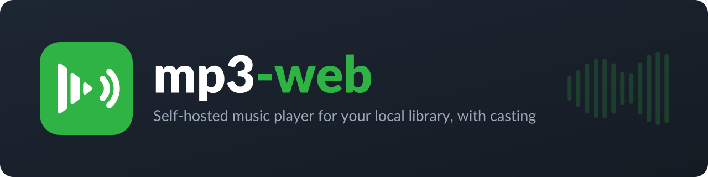

# mp3-web

A lightweight, self-hosted music player for local audio files, written in PHP with a jQuery/Bootstrap frontend.

It's handy when you have a folder of local music you want to play from any browser, and especially when you want to
cast it to Google/Nest speakers (Spotify won't cast local files).

## Screenshots

### Default (new) player


### Legacy (old) player


## Features

- [x] Plays `mp3`, `ogg` and `wav` files from a configurable folder (allowed types are configurable)
- [x] **Cast** to Google Cast / Nest speakers from the playbar (playbar controls, queue and auto-next keep working on the speaker); AirPlay in Safari
- [x] **Cover art** from each song's embedded ID3v2 picture: a thumbnail per row, a larger cover in the playbar, and artwork in the OS media overlay and on Cast speakers (a neutral placeholder when a song has none; see below)
- [x] **Click to select, double-click to play**: a single click selects a song, a double-click (or Enter, or the play button on its cover) plays it
- [x] **Song menu** on right-click, long-press (touch), the context-menu key or <kbd>Shift</kbd>+<kbd>F10</kbd>, and the ⋯ button: play, play next, add to queue, add to a playlist, favorite, download, copy the song name, remove from the shown playlist and delete (with a confirmation). Items you can't use (demo mode, or a listening session you don't control) are hidden
- [x] **Slim playbar**: an opaque bar about 80 px tall, docked to the bottom (or top) of the window: the song (cover, title, favourite, cast status) on the left, the transport controls with the progress bar in the middle, and volume, queue and cast on the right. The page is padded by the bar's height so it never covers the song list. *Play first* and *Random* sit in the page header
- [x] **Phone layout**: on narrow screens the playbar is a compact bar (cover, title, play/pause, next) over the progress slider; the chevron expands the full controls, and the choice is remembered. The song table fits the screen: names wrap to at most two lines and are trimmed with "…" (the full name is the tooltip), and the Queue column is hidden (it is in the ⋯ and long-press menus)
- [x] Live waveform in the playbar that follows the music and freezes when paused
- [x] Media keys and OS media overlay (title, play/pause, next/previous, seek) via the Media Session API
- [x] Keyboard shortcuts (see below)
- [x] Remembers the current song, position, loop and shuffle across page refreshes
- [x] **Listen together**: shared sessions where every device plays the same song in sync (see below)
- [x] **Playlists** and **Favorites**, shared on the server, with drag-to-reorder and M3U import/export (see below)
- [x] Queue ("Add to queue" and "Play next"), shuffle and loop
- [x] **Queue panel**: a side panel with what's playing now, your queue and what plays next (see below)
- [x] Download and delete songs
- [x] Upload files (multiple at once) directly from the web UI
- [x] Track durations (via [`wapmorgan/mp3info`](https://github.com/wapmorgan/Mp3Info))
- [x] Change settings from the GUI (persisted to the config file)
- [x] Seven themes (plus Follow system and custom colors), accent colors, background image, and layout options (see [Settings](#settings))
- [x] Demo mode that disables all file actions
- [x] CSRF protection on state-changing API requests

### Keyboard shortcuts

| Key | Action |
| --- | --- |
| <kbd>Space</kbd> | Play / pause |
| <kbd>←</kbd> / <kbd>→</kbd> | Seek back / forward 5 seconds |
| <kbd>Shift</kbd>+<kbd>←</kbd> / <kbd>Shift</kbd>+<kbd>→</kbd> | Previous / next song |
| <kbd>↑</kbd> / <kbd>↓</kbd> | Volume up / down (moves the selection while the song list has focus) |
| <kbd>M</kbd> | Mute / unmute |
| <kbd>L</kbd> | Toggle loop |
| <kbd>S</kbd> | Toggle shuffle |
| <kbd>A</kbd> | Toggle autoplay (play the next song when one ends) |
| <kbd>Q</kbd> | Show / hide the queue panel |

**In the song list.** Clicking a song selects it and gives the list keyboard focus. While the list has focus:

| Key | Action |
| --- | --- |
| <kbd>↑</kbd> / <kbd>↓</kbd> | Move the selection up / down |
| <kbd>Enter</kbd> | Play the selected song |
| <kbd>☰ Menu</kbd> / <kbd>Shift</kbd>+<kbd>F10</kbd> | Open the song menu for the selected song (<kbd>↑</kbd> / <kbd>↓</kbd> to move, <kbd>Enter</kbd> to choose, <kbd>→</kbd> / <kbd>←</kbd> into and out of "Add to playlist", <kbd>Esc</kbd> to close) |
| <kbd>Esc</kbd> | Leave the list (<kbd>↑</kbd> / <kbd>↓</kbd> control the volume again) |

Clicking anywhere outside the list also gives <kbd>↑</kbd> / <kbd>↓</kbd> back to the volume. Double-click a song to
play it. On touch screens, double-tap it, or tap the play button shown on the cover of the selected song. The queue,
favorite, ⋯, download and delete buttons work with a single click, as before.

### Queue panel

The queue button in the playbar (<kbd>Q</kbd>; on phones it's in the expanded controls) opens a side panel. It
stays open or closed across reloads. It has three sections:

1. **Now playing**: the current song.
2. **Next in queue**: songs you added with *Play next* or *Add to queue* (from the ⋯ menu, right-click, the
   Queue column or a playlist's *Add to queue*). They play before anything else.
3. **Next from: _All songs_ / _playlist name_**: the rest of the library or playlist you started from, in the order
   it will play (up to 100 songs). With shuffle on, songs are picked at random, so none are listed.

In the panel:

- Drag a queued song by its grip to reorder it, or focus it and press <kbd>Alt</kbd>+<kbd>↑</kbd> / <kbd>↓</kbd>.
  Dragging works with a mouse and on touch screens.
- × (or <kbd>Delete</kbd>) removes a song from the queue; *Clear* empties it.
- Click a song (or press <kbd>Enter</kbd>) to play it now. A queued song leaves the queue when played.
- Right-click a song for the usual song menu.

On wide screens the page makes room for the panel. On narrower screens it opens over the song list, and on phones
it fills the screen above the playbar. In a listening session, queue changes are shared like any other playback
change. If you can't control playback, the panel is read-only.

### Cover art

- Covers are read from the ID3v2 `APIC` frame of each file by `cover.php?file=<name>&size=sm|lg`
  (96 px thumbnails and 512 px covers, resized with GD when available). Nothing is read while the page renders, and
  thumbnails are lazy-loaded, so large libraries stay fast.
- Extracted covers are cached in `cache/covers/` (git-ignored; created automatically if the web server can write to
  the app folder). Responses carry `ETag`/`Last-Modified` headers and are versioned by the file's modification time,
  so a retagged file shows its new cover.
- Songs without a cover show a music-note placeholder in the current accent colour. The OS media
  overlay and Cast speakers show `assets/branding/logo.png` instead.

Shortcuts are ignored while typing in a text field.

### Casting

The Cast button sits on the right of the playbar, next to the queue button.

- **Google Cast** works in Chrome and Edge. Chrome only enables it on a **secure origin**: serve the app over HTTPS
  (e.g. behind a reverse proxy), or open it on `localhost`. Over plain HTTP the button is disabled with a tooltip saying so.
- The speaker fetches the audio itself, so the page must be opened via an address the speaker can reach
  (your server's LAN IP or hostname, not `localhost`).
- While casting, play/pause, seek, volume, previous/next, queue, shuffle and loop all control the speaker. Disconnecting
  continues locally (paused) from where the speaker left off.
- In Safari the button opens the AirPlay picker instead.

### Listening sessions

Click the people button in the header to **create** or **join** a session.

- Everyone in a session hears the same song at the same position. Playback is synced by polling the server
  every ~1.5s, and devices that drift more than a second re-seek.
- **Join** with the 8-character code, with an invite link (`…/?join=<code>`, copy it from the session card), by
  scanning the **QR code** on the session card with a phone, or by picking a **public** session from the list in the
  Join card.
- **The host controls playback** (play/pause, seek, skip, queue, loop, shuffle). Listeners' controls are dimmed.
  The host can switch on *Let everyone control playback* to make the session a shared jukebox.
- Set **your name** at the top of the dialog (it is remembered in this browser and can be changed at any time, even
  mid-session). The session card lists every member by name, with the host marked and idle members shown as *away*.
- Volume is per device and is never synced. Casting works inside a session too.
- If the host leaves or goes quiet for a minute, the longest-joined listener becomes host. Sessions with no activity
  for 24 hours are deleted.
- After a page refresh you stay in the session. If the browser blocks autoplay, click *Tap to start listening*
  under the song title.
- Session state is stored as JSON files in `session/`, which must be writable by the web server.

### Playlists

The pills above the song list switch between **All songs**, **Favorites** and your playlists.

- **Create** a playlist with *New playlist*, or **import** an `.m3u` / `.m3u8` file. Songs are matched to your library
  by file name, and any that aren't found are listed.
- **Add songs** from a song's ⋯ menu (*Add to playlist*), which also has *Play next*, *Add to queue* and
  *Add to Favorites*. The heart next to a song, or next to the title in the player, toggles Favorites.
- **Play** or **Shuffle** a playlist from its header, or add all of it to the queue. Next, previous and shuffle stay
  inside the playlist you started from, even if you switch the list to another view.
- **Reorder** by dragging songs (when the list isn't sorted or searched), or with *Move up* / *Move down* in the ⋯ menu.
- **Rename**, **export** (`.m3u` with links to the songs, playable in e.g. VLC) or **delete** from the playlist's ⋯ menu.
- Playlists are stored as JSON files in `playlists/` and shared by everyone using this server. If a song file is
  removed, it stays in the playlist (shown as "not in library") and comes back if the file returns.

## Requirements

- PHP 8.x with a web server (Apache, nginx + PHP-FPM, etc.)
- [Composer](https://getcomposer.org/)
- Write access for the web server user to the music folder (uploads/deletes), the config file (GUI settings) and `session/` (and optionally `cache/` for cached cover art)

## Getting started

### Docker (recommended)

The [Dockerfile](Dockerfile) builds a `php:8.3-apache` image, clones the `main` branch of this repo and runs `composer install`.

```bash
# Get the Dockerfile
curl -O https://raw.githubusercontent.com/Darknetzz/mp3-web/refs/heads/main/Dockerfile

# Build the image
docker build -t mp3-web:main .

# Run the container (replace 9096 with any port you want)
docker run -d -p 9096:80 mp3-web:main
```

To use your own music, mount it over the music folder:

```bash
docker run -d -p 9096:80 -v /path/to/your/music:/var/www/html/music mp3-web:main
```

### Docker Compose

```yml
services:
  mp3-web:
    build: .            # directory containing the Dockerfile
    image: mp3-web:main
    container_name: mp3-web
    ports:
      - "9096:80"
    volumes:
      - /path/to/your/music:/var/www/html/music
    restart: unless-stopped
```

### Manual

1. Clone this repo (or download the [latest release](https://github.com/Darknetzz/mp3-web/releases/latest)) into your web root.
2. Install dependencies (required, the app won't start without `vendor/autoload.php`):
   ```bash
   composer install
   ```
3. Make sure a `.env` file exists in the project root (see [Environment](#environment-env)).
4. Put some music in the `music` folder (or whichever folder `audio_path` points to).
5. Open the page in a browser and start listening.

## Configuration

### Settings

Open **Settings** (gear button) to change everything from the browser: settings are grouped into General, Library,
Playback, Appearance, Layout and Background, with a search box. Changes are saved immediately; most apply after a reload.

Where settings live:

- `config.default.php` defines every setting (name, type, options, default). Don't edit it to change settings.
- `config.local.php` (git-ignored), or `config.php` if there is no local file, holds your values. Only the values are
  read from it, so new settings and options added in updates show up automatically with their defaults.
- The settings dialog writes to that active file, so it must be writable by the web server.

| Key | Default | Description |
| --- | --- | --- |
| **General** | | |
| `site_title` | `Music Player` | Header and browser tab title |
| `no_song_text` | `No song selected` | Player text when nothing is selected |
| `env` | `dev` | `dev`, `prod` or `demo` (demo disables uploads, deletes, settings and sessions) |
| **Library** | | |
| `audio_path` | `music` | Folder containing the audio files |
| `allowed_types` | `mp3, ogg, wav` | Extensions that are listed and accepted for upload |
| `include_file_extension` | `true` | Show file extensions in song names |
| `default_sort` / `default_sort_order` | `none` / `asc` | Initial sort of the song list (name, duration, size, date added) |
| `default_table_cols` | `name, duration, queue` | Columns shown in the song table |
| **Playback** | | |
| `autoplay_next` | `true` | Play the next song automatically; when off, playback stops after each song |
| `default_volume` | `0.5` | Starting volume (the last used volume is remembered per browser) |
| `seek_step` | `5` | Seconds jumped by ←/→ and media seek buttons |
| `start_shuffle` / `start_loop` | `false` | Turn shuffle / loop on when the page loads |
| `remember_position` | `true` | Restore song, position, loop and shuffle after a refresh |
| `auto_scroll` | `true` | Keep the playing song in view |
| `use_legacy_player` | `false` | Use the browser's built-in audio controls |
| **Appearance** | | |
| `player_theme` | `dark` | See [Themes](#themes) |
| `accent_color` | `green` | green, blue, purple, pink, orange, red, teal, yellow or `custom` |
| `custom_accent` | `#1db954` | Accent when `accent_color` is `custom` |
| `custom_base`, `custom_background`, `custom_surface`, `custom_text` | dark, `#121212`, `#1e1e1e`, `#f0f0f0` | Colors for the `custom` theme |
| **Layout** | | |
| `player_position` | `bottom` | Player bar at the `bottom` or `top` |
| `show_waveform`, `show_quick_buttons`, `show_upload` | `true` | Show the waveform, the Play first/Random buttons in the page header, the upload box |
| `compact_rows` | `false` | Tighter song list rows |
| `fluid-container` | `false` | Full-width layout |
| **Background** | | |
| `background_image` | empty | Image URL (`https://…`) or relative path (`img/bg.jpg`) |
| `background_dim` / `background_blur` | `0.6` / `0` | Darken (or lighten, on light themes) and blur the image |

### Themes

`player_theme` offers **Follow system** (switches between Light and Dark with your device), **Light**, **Arctic**
(cool light), **Dark**, **OLED black**, **Midnight** (navy), **Forest** (deep green), **Sunset** (warm plum) and
**Custom colors**, where you pick the background, surface and text colors and whether they build on the light or dark
look. Combine any theme with an accent color, and optionally a background image.

### Environment (`.env`)

Loaded with [`vlucas/phpdotenv`](https://github.com/vlucas/phpdotenv). The app refuses to start without it.

```ini
APP_NAME = "mp3-web"
AUTHOR   = "..."
URL      = "https://github.com/Darknetzz/mp3-web"   # linked from the version label in the header
ENV      = "prod"
VERSION  = "vX.Y.Z"                                 # shown next to the site title
```

## Project structure

| Path | Purpose |
| --- | --- |
| `index.php` | Main page: player, song table, upload form |
| `_includes.php` | Bootstrap: session + CSRF token, Composer autoload, `.env`, config loading, constants |
| `functions.php` | Helpers: config read/write, listing, upload, delete, durations, `apiResponse()` |
| `sessions.php` | Listening sessions: storage (locked JSON files), membership, host handover, sync API |
| `playlists.php` | Playlists and Favorites: storage (locked JSON files), M3U import/export |
| `api.php` | JSON API used by the frontend |
| `js.php` | Frontend logic (jQuery), served inline |
| `modals.php` | Settings and session modals |
| `cast.js` | Google Cast sender + AirPlay fallback |
| `waveform.js` | Playbar waveform (Web Audio analyser) |
| `session.js` | Listening session sync and session modal |
| `playlists.js` | Playlist bar and views, ⋯ song menu, favorites, drag-to-reorder |
| `style.css` | Custom styles |
| `music/` | Default audio folder (ships with a few sample tracks) |
| `session/` | Listening session JSON files (created at runtime, git-ignored) |
| `playlists/` | Playlist JSON files (created at runtime, git-ignored) |
| `Dockerfile` | Container image definition |
| `IMPROVEMENTS.md` | Notes on known issues and suggested improvements |

## API

All endpoints live in `api.php` and always return JSON shaped like `{ "status": "success" | "error", "response": "...", "data": {...} }`.
The action is passed as `action` in the query string or POST body. State-changing actions require a POST with a valid
`csrf_token` (the frontend handles this automatically).

| Action | Description |
| --- | --- |
| `ls` | List songs in the audio folder |
| `dl` | Download a song (`file`) |
| `rm` | Delete a song |
| `getconfig` | Read the current configuration |
| `setconfig` | Update a setting |
| *(file upload)* | Any request with `$_FILES` is treated as an upload |
| `createSession` / `joinSession` / `leaveSession` | Create (`name`, `public`), join (`sessionCode`) or leave a listening session |
| `listSessions` | Public sessions with active listeners |
| `sessionState` | Current session state (polled by members) |
| `sessionUpdate` | Publish playback state (`state` JSON, optional `if_version` for compare-and-swap) |
| `setDisplayName` | Set your display name (`name`, max 30 characters); also updates it in your current session |
| `sessionSettings` | Host only: `allow_all` lets everyone control playback |
| `listPlaylists` / `getPlaylist` | Playlist summaries; one playlist's songs (`id`; `favorites` is built in) |
| `createPlaylist` / `renamePlaylist` / `deletePlaylist` | Manage playlists (`name`, `id`, optional `songs[]`) |
| `addToPlaylist` / `removeFromPlaylist` | Add `songs[]` / remove `song` |
| `reorderPlaylist` | New order (`songs[]`, `if_version`); returns `conflict` if the playlist changed meanwhile |
| `toggleFavorite` | Add or remove `song` from Favorites |
| `exportPlaylist` / `importPlaylist` | Download as `.m3u` (GET `id`); create from an uploaded `playlist` file |

> **Note:** there is no authentication. Anyone who can reach the page can upload, delete and change settings,
> so don't expose it to the internet without putting it behind auth (reverse proxy, VPN, etc.), or set `env` to `demo`.

## Troubleshooting

### Unable to upload/delete music or save settings

This is almost always file permissions. You may see errors like *The directory `<PATH>` is not writable.*
Run the following, replacing `<PATH>` with the mp3-web directory:

```bash
# Example: chown -R www-data:www-data /var/www/html/mp3-web
chown -R www-data:www-data <PATH>
```

```bash
# Example: chmod -R 775 /var/www/html/mp3-web
chmod -R 775 <PATH>
```

If your music folder is on a remote share where ownership can't be changed, you may have to use `777` instead of `775`.

### Large uploads fail

Raise `upload_max_filesize` and `post_max_size` in your PHP config (the Docker image sets both to `50M`).

### "The Composer autoload file is missing." / "The .env file is missing."

Run `composer install` in the project directory and make sure `.env` exists.
